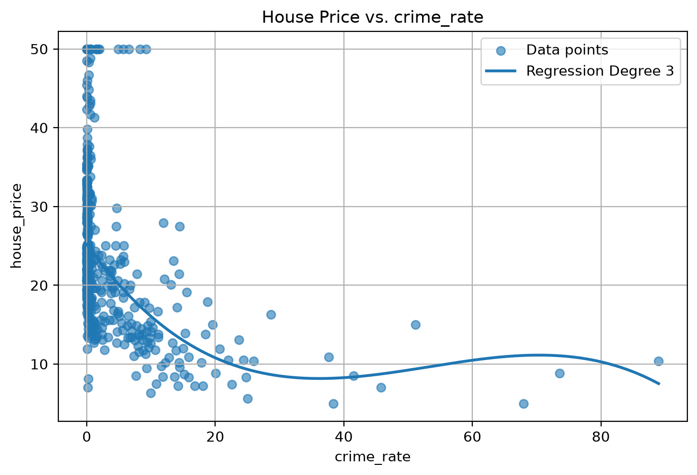
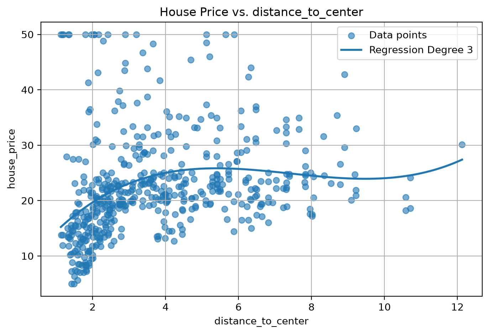
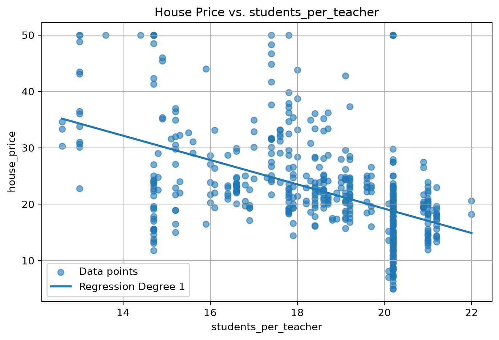

# Boston Housing Regression Analysis

Academic data science project exploring housing prices using polynomial regression, cross-validation, and data visualization in Python.

## Project Overview

This project analyzes the relationship between housing prices and selected socioeconomic variables using regression techniques.

The analysis focuses on three explanatory variables:

- `crime_rate`
- `distance_to_center`
- `students_per_teacher`

The target variable is:

- `house_price`

The main objective is to investigate whether these variables are associated with housing prices and whether linear or polynomial regression provides a better representation of each relationship.

## Research Questions

The analysis addresses the following questions:

1. Do property prices tend to decrease as crime rates increase?
2. How are housing prices related to the distance from the center?
3. Are better educational conditions associated with higher housing prices?
4. Are these relationships approximately linear?
5. Which polynomial regression degree best describes each relationship?

## Dataset

The project uses an adapted version of the Boston Housing dataset provided for academic coursework.

For this analysis, the dataset contains the following variables:

| Variable | Description |
|---|---|
| `house_price` | Housing price used as the target variable |
| `crime_rate` | Crime rate |
| `distance_to_center` | Distance-related variable used in the coursework dataset |
| `students_per_teacher` | Number of students per teacher |

The dataset is stored in:

```text
boston_housing.csv
```

## Methodology

The analysis follows these main steps:

1. Load and inspect the dataset using Pandas.
2. Generate descriptive statistics.
3. Calculate the correlation between each explanatory variable and house prices.
4. Train polynomial regression models with degrees from 1 to 5.
5. Evaluate the models using 5-fold cross-validation.
6. Compare the mean cross-validation R² scores.
7. Select the best polynomial degree for each explanatory variable.
8. Calculate training R² and RMSE.
9. Generate regression curves and visualizations.
10. Export the model comparison results to a CSV file.

## Model Selection

For each variable, polynomial regression models with the following degrees are evaluated:

```text
1, 2, 3, 4, 5
```

A pipeline combining:

- `PolynomialFeatures`
- `LinearRegression`

is used for each model.

The models are compared using 5-fold cross-validation with:

```python
KFold(n_splits=5, shuffle=True, random_state=42)
```

The best polynomial degree for each variable is selected according to the highest mean cross-validation R² score.

## Evaluation Metrics

### R²

The coefficient of determination measures how much of the variation in housing prices is explained by the regression model.

### Cross-Validation R²

5-fold cross-validation is used to compare the polynomial models and reduce the risk of selecting a model only because it performs well on the training data.

### RMSE

Root Mean Squared Error measures the average prediction error in the same units as the target variable.

In this implementation, RMSE is calculated using predictions on the training dataset.

## Results

### Crime Rate

The analysis indicates a negative relationship between crime rate and house price.

Higher crime rates tend to be associated with lower housing prices.

The relationship is not perfectly linear, and a polynomial model can describe the observed relationship better than a simple linear regression.



### Distance to Center

In the coursework dataset, higher `distance_to_center` values represent greater distance.

The analysis shows a positive but relatively weak relationship between this variable and housing prices.

In this dataset, higher values of `distance_to_center` are associated on average with higher housing prices.



### Students per Teacher

The variable `students_per_teacher` represents the number of students per teacher.

Lower values represent fewer students per teacher.

The analysis shows a negative relationship between `students_per_teacher` and housing prices.

This suggests that observations with fewer students per teacher tend to be associated with higher housing prices.



## Interpretation

The analysis identifies statistical relationships between the selected variables and housing prices.

These relationships should be interpreted as **associations rather than causal effects**.

The purpose of the project is primarily to explore regression modeling, model comparison, cross-validation, and data interpretation.

## Technologies

- Python
- Pandas
- NumPy
- Matplotlib
- scikit-learn

## Repository Structure

```text
boston-housing-regression-analysis/
│
├── README.md
├── boston_housing_analysis.py
├── boston_housing.csv
├── regression_results.csv
├── plot_crime_rate.png
├── plot_distance_to_center.png
├── plot_students_per_teacher.png
├── requirements.txt
└── .gitignore
```

## Installation

Clone the repository:

```bash
git clone https://github.com/AntonVera/boston-housing-regression-analysis.git
```

Move into the project directory:

```bash
cd boston-housing-regression-analysis
```

Install the required packages:

```bash
pip install -r requirements.txt
```

## Running the Analysis

Run:

```bash
python boston_housing_analysis.py
```

The script will:

- Load the dataset
- Display descriptive statistics
- Evaluate polynomial regression models
- Select the best polynomial degree for each variable
- Print the model comparison results
- Export `regression_results.csv`
- Generate the regression plots

## Academic Context

This project was developed independently as part of coursework at **FAU Erlangen-Nürnberg**.

The assignment specification and research questions were provided by the course.

The implementation, regression analysis, model comparison, cross-validation, visualization, and interpretation presented in this repository were completed independently by me.

## Author

**Antonio Vera**

B.Sc. Data Science  
FAU Erlangen-Nürnberg

[LinkedIn](https://www.linkedin.com/in/antonio-vera-datascience/)
